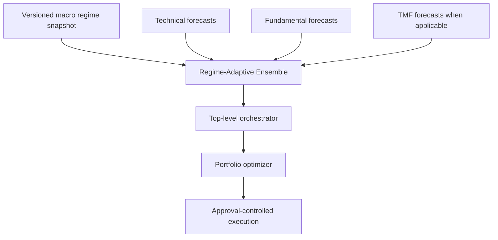

# Regime-Adaptive Ensemble Engine

**RAE-001 · Experimental foundation · Research only**

Independent, versioned **mixture-of-experts** research component in the [Systematic Trading Research Platform](https://github.com/enriquespinoza/Systematic-Trading-Research-Platform). This engine **combines compatible, frozen forecasts** using point-in-time macro regime probabilities and independently evaluated forecast reliability. It does **not** select securities, optimize a portfolio, authorize trades, or connect to a broker.

> The default policy and example are **synthetic demonstrations**, not estimated market parameters or evidence of an investment edge. This repository has not passed out-of-sample, prospective, or paper-trading validation.

## Where it fits



- The **Stock Scanner** determines candidate eligibility, but is not automatically a calibrated forecasting expert.
- **Stock Technical Analysis**, **Stock Fundamental Forecast**, and **TMF Intraday Predictive Analytics** remain independent producers. A model can participate only when it emits an eligible forecast for the *same asset, horizon, and origin*.
- The upstream macro research/orchestrator publishes `macro_regime_snapshot_v1`. RAE-001 consumes its **probabilities**; it does not yet infer regimes from raw economic series.
- The ensemble returns a research forecast and traceable weights for the **orchestrator** to evaluate. The **optimizer** alone controls allocations, and the **execution engine** alone handles approval-controlled orders.
- No live market data, credentials, brokerage access, or real portfolio positions are required to run RAE-001.

## What RAE-001 implements

1. Versioned, strict JSON contracts for macro snapshots, expert forecasts, reliability evidence, policy and output.
2. Point-in-time guards: UTC-aware availability times, common forecast origin, asset/horizon matching, model-version consistency, age limits, and matured reliability evidence that predates the forecast.
3. Deterministic **soft regime weighting** of precommitted expert priors, multiplied by evidence-based reliability scores.
4. Hard maximum expert-weight cap with proportional redistribution; previous-weight stability gate.
5. `HOLD_FOR_REVIEW` for ineligible evidence (no partial or silent fallback); schema violations fail validation.
6. Content fingerprints and references to each contributing forecast/reliability/macro artifact.
7. Cross-platform unit tests and GitHub Actions CI.

Initial policy formula, for expert \(i\) and regime \(r\):

\[
\tilde{w}_i = q_i \sum_r P(r\mid I_t) b_{r,i}, \quad
w = \operatorname{normalize\_and\_cap}(\tilde{w}), \quad
\widehat{\mu}=\sum_i w_i\widehat{\mu}_i
\]

Here \(q_i\) is a pre-existing, audited reliability score based only on matured out-of-sample outcomes; \(b_{r,i}\) is an explicitly versioned **research prior**, not a trained or proven optimal parameter. Probabilities of positive returns are combined using the same weights. This linear pool is a baseline; it is **not** a calibrated joint distribution.

## Try the synthetic fixture

Python 3.11 or 3.12; runtime has no third-party dependencies.

```bash
git clone https://github.com/enriquespinoza/Regime-Adaptive-Ensemble-Engine.git
cd Regime-Adaptive-Ensemble-Engine
python -m pip install -e .
python -m unittest discover -s tests -v
python -m regime_ensemble.cli \
  --input examples/synthetic_tmf_run.json \
  --policy config/ensemble_policy_v1.json \
  --output reports/generated/synthetic_decision.json
```

The CLI exits `0` for research-only output, `1` for a valid but held bundle, and `2` for invalid input. The output contains `status: RESEARCH_ONLY` **only in the sense of input eligibility**. It does not mean a model is approved for use in real trading.

## Contracts, controls and research gates

- [Input/output contracts](docs/contracts.md)
- [Engine boundaries and workflow](docs/architecture.md)
- [RAE-001 validation plan](docs/research_validation.md)

**Status:** RAE-001 foundation implemented; independent source adapters, model-specific reliability estimation, macro regime classifier, backtesting, forward evaluation, integration audit registry, and paper trading remain **pending**. Do not promote this engine to `VALIDATED` or `FROZEN` until the full evidence gates pass.

This repository intentionally excludes private/licensed market datasets and secrets. Only synthetic example data is committed.
